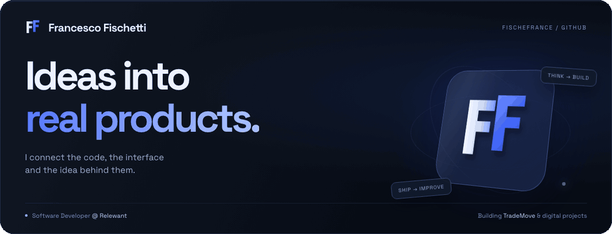
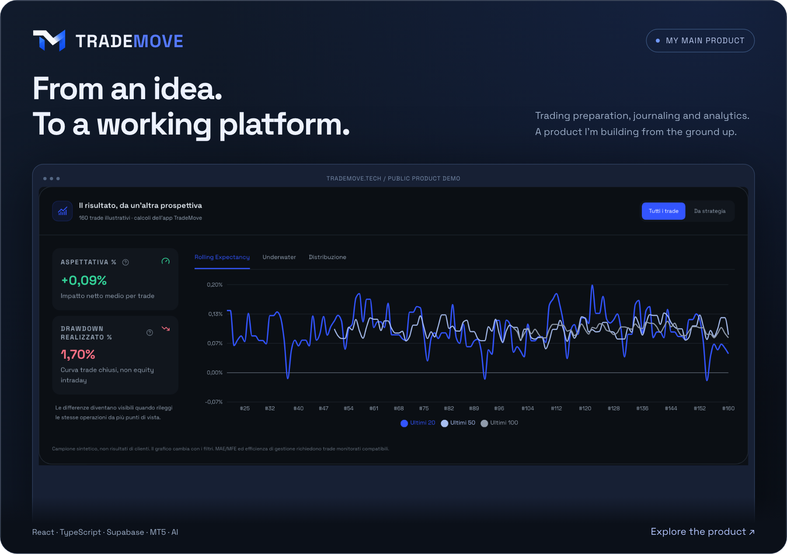
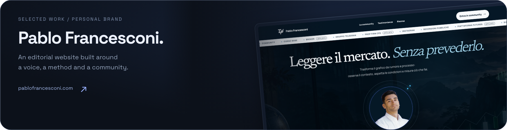
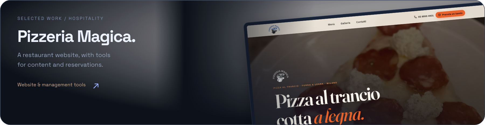

<picture>
  <source media="(max-width: 600px)" srcset="./assets/profile-cover-mobile.png">
  <source media="(prefers-reduced-motion: reduce)" srcset="./assets/profile-cover-v2.png">
  
</picture>

  <a href="#about-me">About</a> &nbsp; / &nbsp;
  <a href="#selected-work">Work</a> &nbsp; / &nbsp;
  <a href="#toolkit">Stack</a> &nbsp; / &nbsp;
  <a href="https://www.linkedin.com/in/francesco-fischetti-7325791ba/">Contact ↗</a>

### About me

**I’m Francesco — a developer with a product mindset.**

I work with **Java and Spring at Relewant**, in Chiasso. Outside work, I build apps and websites of my own: from the first idea and the interface to the integrations that make them work.

My main project is **TradeMove**. My direction is to build my own business through useful digital products.

 

### Selected work

<a href="https://www.trademove.tech/">
  <picture>
    <source media="(max-width: 600px)" srcset="./assets/trademove-feature-mobile.png">
    
  </picture>
</a>

**My work:** product concept, interface design, development, integrations and deployment.

MT5 connections · Trading Journal · Playbooks & Case Studies · Performance analytics · News & COT reports · AI-assisted review

[**Explore TradeMove ↗**](https://www.trademove.tech/)

 

<a href="https://pablofrancesconi.com/">
  <picture>
    <source media="(max-width: 600px)" srcset="./assets/pablo-project-mobile.png">
    
  </picture>
</a>

<a href="https://pizzeria-magica.vercel.app/">
  <picture>
    <source media="(max-width: 600px)" srcset="./assets/magica-project-mobile.png">
    
  </picture>
</a>

 

### Toolkit

**Backend** &nbsp; `Java` `Spring Boot` `Spring Batch` `Oracle` `SQL`

**Interfaces** &nbsp; `React` `Next.js` `TypeScript` `Responsive UI`

**Product infrastructure** &nbsp; `Supabase` `PostgreSQL` `REST APIs` `Vercel` `Git`

<b>How these fit together</b>

I use Java and Spring in my professional backend work. In my own products, React and TypeScript connect the interface to data, external services and AI features. I follow these projects through development, publication and ongoing improvements.

---

### An idea worth building?

A product, a website, or a collaboration — **[let’s talk on LinkedIn ↗](https://www.linkedin.com/in/francesco-fischetti-7325791ba/)**

Francesco Fischetti / FischeFrance &nbsp; · &nbsp; Backend. Interfaces. Products.
