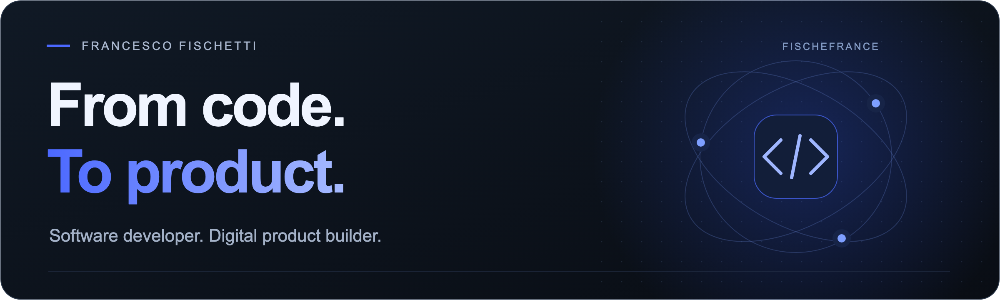
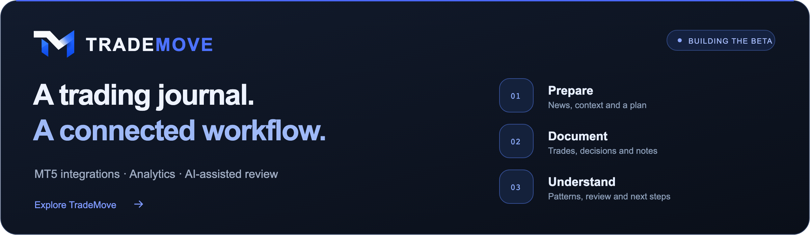

<picture>
  
</picture>

### Hi, I’m Francesco.

I build backends, apps and websites — and enjoy connecting the engineering behind a product with the experience of using it.

By day, I work as a **Software Developer at Relewant**, in Chiasso, Switzerland. Alongside that, I’m building **TradeMove** and developing digital projects of my own.

**My direction:** turn ideas into useful products, follow them through to release, and keep improving them.

 

### Currently building · TradeMove

A platform that connects trading preparation, execution and review. I work on the product concept, interfaces, backend integrations and deployment.

- **Connect:** MetaTrader 5 integrations and account history.
- **Document:** a trading journal, Case Studies, Playbooks and Highlights.
- **Understand:** performance analytics, economic news, COT reports and AI-assisted review.

[**Explore TradeMove ↗**](https://www.trademove.tech/)

 

### What I work with

| Backend & data | Apps & interfaces | Integration & delivery |
| :--- | :--- | :--- |
| Java · Spring Boot · Spring Batch | React · Next.js · TypeScript | REST APIs · Supabase · PostgreSQL |
| Oracle · SQL | Responsive UI · Product workflows | Vercel · Git · AI integrations |

### Beyond the main project

I also build websites and tools for real businesses, including **Pizzeria Magica** and **Pablo Francesconi’s website**. Different contexts, the same interest: shaping an idea into something people can use.

---

**Have a product or a collaboration in mind?** [Let’s connect on LinkedIn ↗](https://www.linkedin.com/in/francesco-fischetti-7325791ba/)

Francesco Fischetti · FischeFrance · Backend, apps & digital products.
